# G-Scores

[](https://github.com/TinMH/G-Scores/actions/workflows/ci.yml)

Look up, rank and analyse the **2024 Vietnamese national high-school exam results**: 1,061,605 candidates, 9 subjects.
Built for the [Golden Owl](https://goldenowl.asia) web developer intern assignment ([original brief](docs/ASSIGNMENT.md)).

### 🔗 Live demo: **https://gscores.appforsell.com**

<p align="center">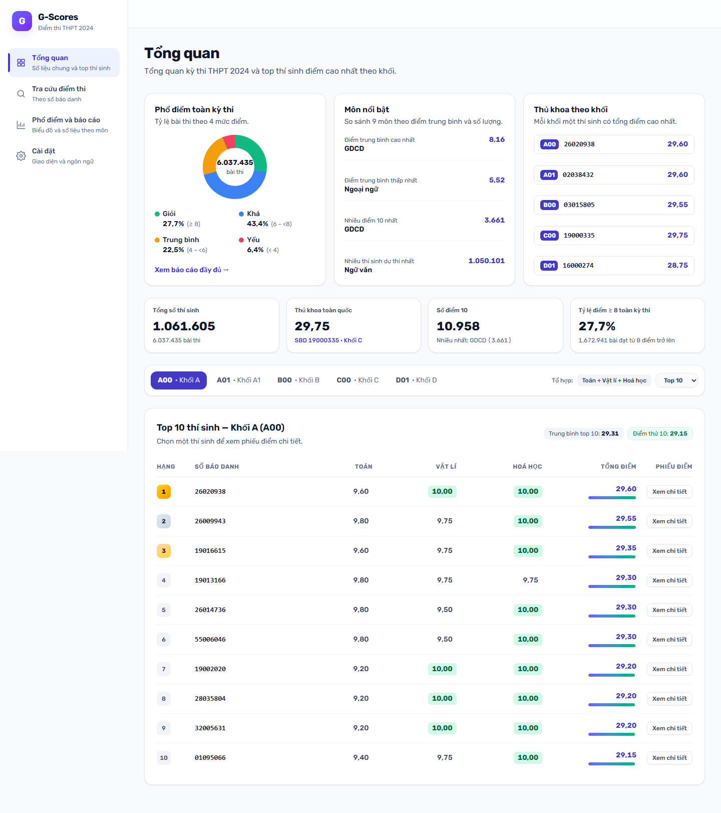</p>

## Features

- **Dashboard**: overall score distribution, standout subjects, top scorer of every group, headline numbers, and the **top candidates by group** (A00, A01, B00, C00, D01) with Top 10 / 20 / 50 and pagination
- **Score lookup** by 8-digit registration number: all 9 subjects coloured by level, plus the totals of every admission group the candidate qualifies for
- **Reports**: how many candidates fall in each of the **4 score levels** (≥ 8, 6–8, 4–6, < 4) for every subject, as a stacked bar chart, a pie chart per subject, and a data table
- **Settings**: Vietnamese / English, light / dark / system theme, text size, and the Dashboard defaults, all persisted in the browser
- Responsive from 375 px phones through tablets to desktop (the sidebar becomes a drawer below 1024 px), keyboard accessible, respects reduced motion
- Fast: every endpoint answers in **under 10 ms at the 95th percentile** on 1M+ rows (see [API](#api))

## Screenshots

The app adapts to the screen: a permanent sidebar from 1024 px (desktop and landscape tablets), a menu drawer below that
(portrait tablets and phones), and cards instead of tables below 1280 px.

### Desktop (1440 px)

<table>
  <tr>
    <td>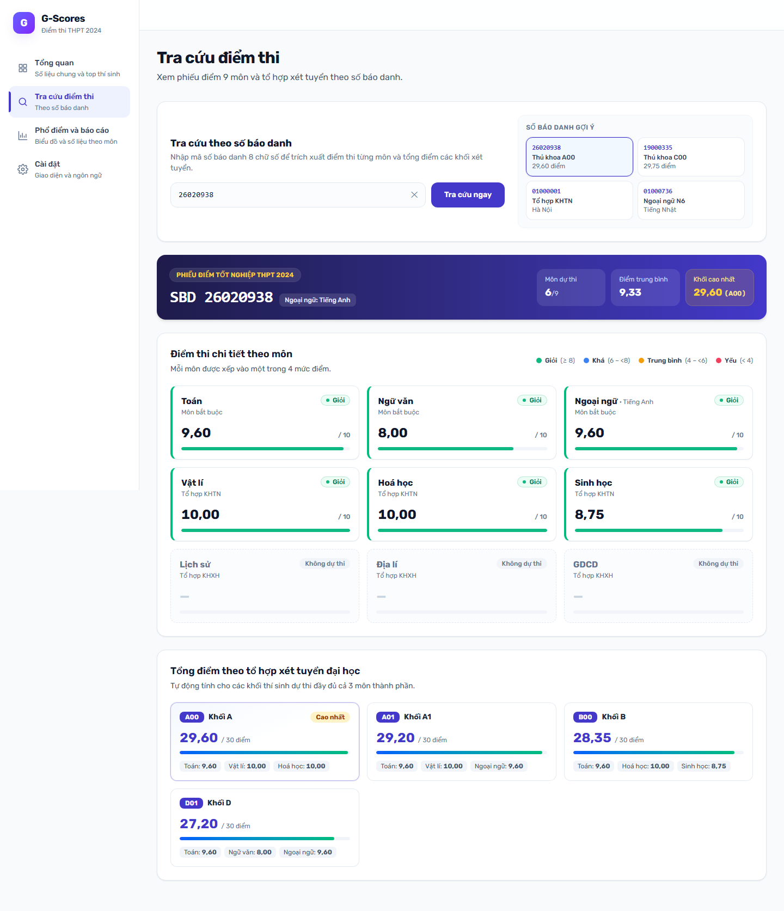</td>
    <td>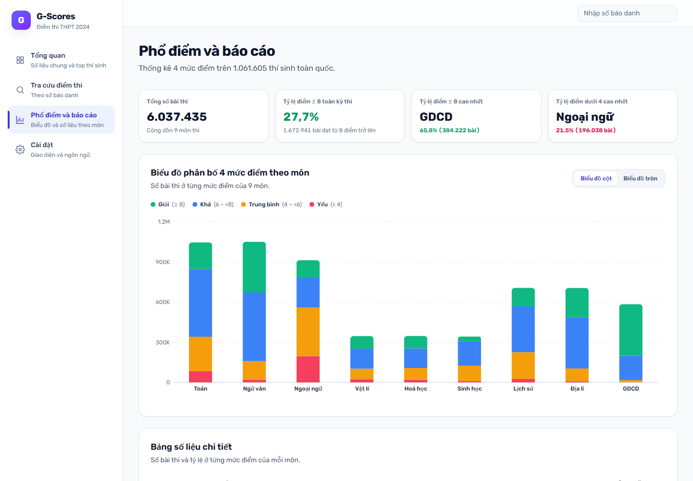</td>
  </tr>
  <tr>
    <td>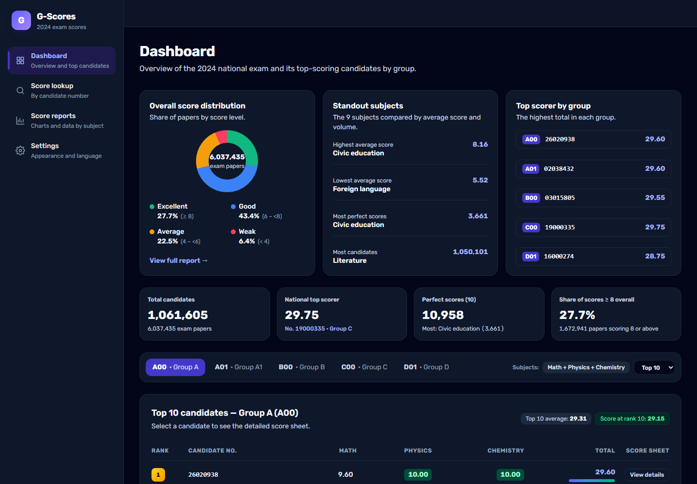</td>
    <td>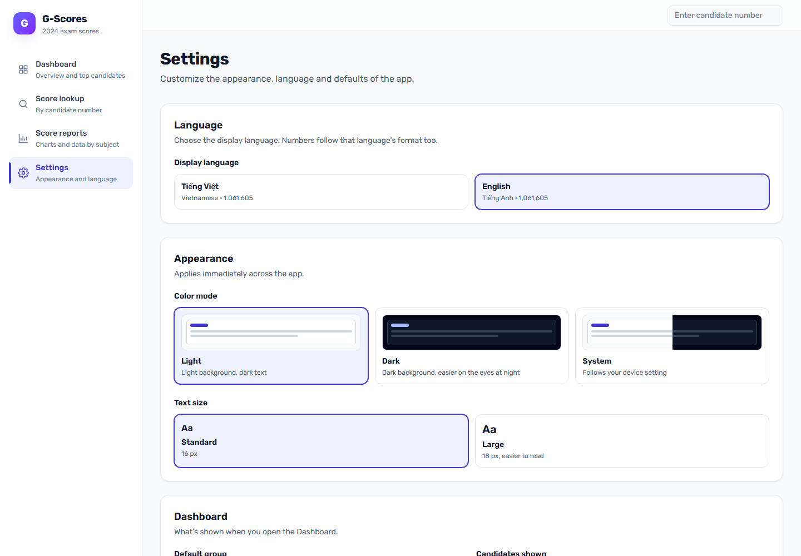</td>
  </tr>
</table>

### Tablet (820 px, portrait)

<p align="center">
  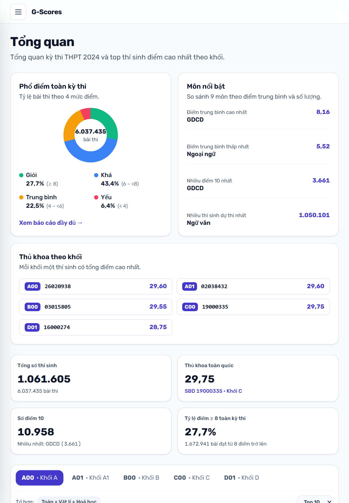
  &nbsp;
  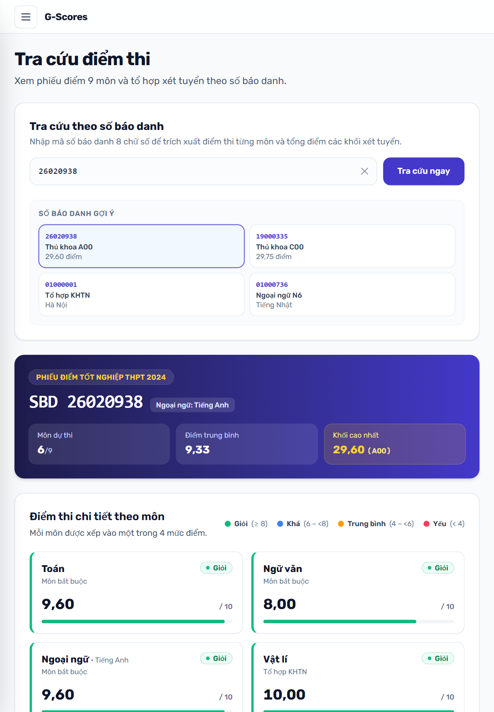
  &nbsp;
  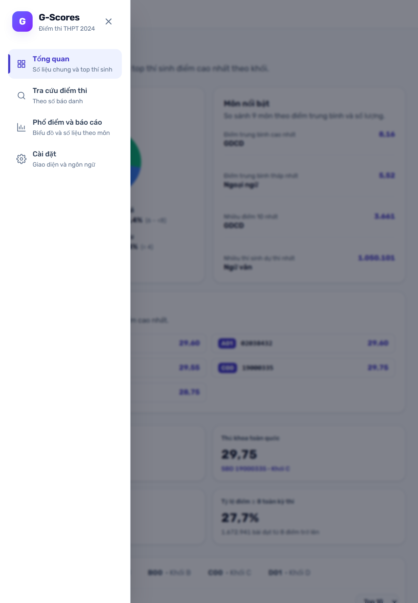
</p>

### Mobile (390 px)

<p align="center">
  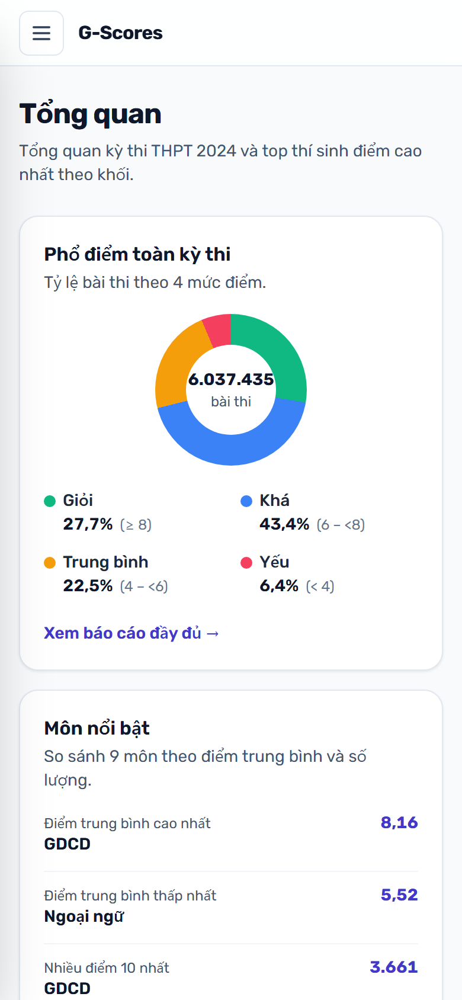
  &nbsp;&nbsp;
  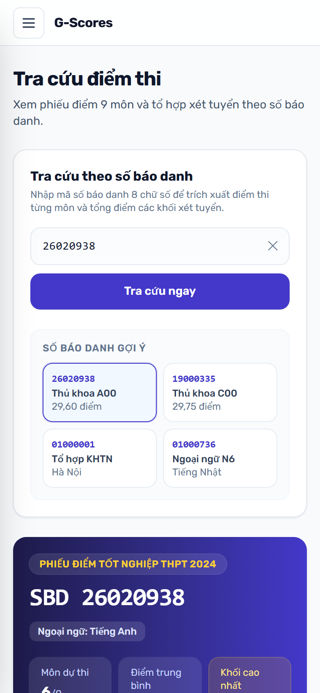
</p>

## Quick start (Docker)

Requires Docker only.

```bash
docker compose up --build
```

The first start loads the CSV into Postgres (about 30 seconds), then:

| | |
|---|---|
| App | http://localhost:8080 |
| API + Swagger docs | http://localhost:3000/api/docs |
| PostgreSQL | `localhost:5433` (user / password / database `gscores`) |

`docker compose down` stops it; add `-v` to also delete the database volume.

## Local development

Requires Node 22+ and Docker (for Postgres).

```bash
docker compose up -d postgres                 # PostgreSQL on :5433

# API
cd backend
cp .env.example .env
npm ci
npm run migrate                               # creates the tables
npm run seed                                  # loads the 1,061,605 rows from ../dataset (≈ 15–30 s), then builds the stats
npm run start:dev                             # http://localhost:3000, Swagger on /api/docs

# Web (another terminal)
cd frontend
npm ci
npm run dev                                   # http://localhost:5173 (proxies /api to :3000)
```

`npm run seed` is idempotent (it skips when the data is already there; `-- --force` reloads), and `npm run stats:refresh`
rebuilds the pre-aggregated tables on their own.

## API

| Method | Endpoint | Description | avg | p95 |
|---|---|---|---|---|
| GET | `/api/health` | API and database health check | **3.7 ms** | 7 ms |
| GET | `/api/students/:sbd` | Look up a score sheet by 8-digit candidate number (primary-key lookup) | **4.7 ms** | 8 ms |
| GET | `/api/reports/score-levels` | Score distribution in 4 levels for all 9 subjects (pre-aggregated at seed time) | **4.3 ms** | 7 ms |
| GET | `/api/rankings/:group?limit=10` | Top N candidates of a group (`A00`, `A01`, `B00`, `C00`, `D01`; N up to 100), from an expression index | **4.5 ms** | 7 ms |
| GET | `/api/overview` | Totals, top scorers and per-subject stats (pre-aggregated at seed time) | **4 ms** | 7 ms |
| GET | `/api/subjects` | Subject and group catalog | **2.3 ms** | 4 ms |

<sub>Measured with newman (`cd testing && npm run bench`): 200 iterations after 10 warm-up, on a 13th Gen Intel Core i5-1335U (12 threads),
16 GB RAM, Node 24, Postgres 16 in Docker, 1,061,605 candidates. These are server-side times; over the internet add network
latency (the live site is behind Cloudflare). Numbers depend on the machine.</sub>

```bash
curl http://localhost:3000/api/students/26020938          # score sheet
curl "http://localhost:3000/api/rankings/A00?limit=3"     # top 3 of group A
```

Inputs are validated: a malformed registration number is a `400` (`^\d{8}$`), an unknown one a `404`, `limit` must be 1–100, unknown
query parameters are rejected. Each client IP is limited to 60 requests per minute. Interactive docs: `/api/docs`.

## How it works

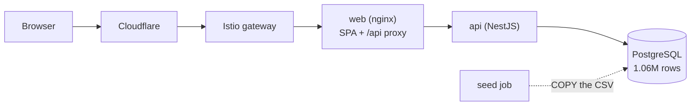

The hard part is 1M+ rows, so the work is moved to where it is cheap:

- **Bulk load with `COPY`.** The seeder streams the CSV straight into Postgres (≈ 13–23 s for 1,061,605 rows; row-by-row ORM inserts
  would take minutes). Empty CSV cells become `NULL`. It is idempotent and rebuilds the stats afterwards.
- **One wide table.** `students` has one `NUMERIC(4,2)` nullable column per subject; a lookup is a primary-key read and there are no joins.
- **Indexes shaped like the queries.** Each admission group has an expression index such as `(toan + vat_li + hoa_hoc) DESC`, so the top N
  of a group is an index scan, not a sort of a million rows.
- **ORM where it fits, SQL where it matters.** TypeORM owns the entities (`Student`, `SubjectScoreStat`), the repositories (the score lookup and
  the report read), the data source and the migration runner. A few statements are raw SQL through that same TypeORM data source, on purpose:
  the **top-N ranking**, so the `ORDER BY` is exactly the indexed expression the `SubjectRegistry` generates; the **`COPY` bulk load**, which is not
  an ORM operation and is what turns minutes of row-by-row inserts into seconds; the **stats aggregation**, one set-based pass over a million rows
  that would be slow and awkward as entities; and the **migrations**, which create the expression indexes. No user input is concatenated into
  any of them: the only request value, the ranking `limit`, is a bound parameter; the rest is fixed text (migrations) or generated from the registry (ranking, stats).
- **Pre-aggregated reports.** The 4-level counts per subject and the dashboard numbers (totals, per-subject averages, top scorers) are computed
  once at seed time into two tiny tables, so the report endpoints read a few dozen rows.
- **Object-oriented subjects (required by the brief).** `Subject` is an abstract class specialised as `CoreSubject`, `NaturalScienceSubject`,
  `SocialScienceSubject` and `ForeignLanguageSubject`; `SubjectGroup` composes subjects into admission groups and computes totals;
  `SubjectRegistry` is the single source of truth. Reports, ranking, lookup and the seeder's SQL all read from it, so nothing hard-codes a subject.

| Layer | Stack |
|---|---|
| API | NestJS 11, TypeScript, TypeORM 0.3, `class-validator`, Swagger, throttler |
| Database | PostgreSQL 16 (migrations, `COPY` seeder, expression indexes) |
| Web | React 19 (hooks), Vite 6, Tailwind CSS 4, Recharts, React Router 7, Rubik font |
| Tests | Jest (unit + e2e), newman / Postman; CI also runs kubeconform and hadolint |
| Delivery | Docker (multi-stage), docker compose, Kubernetes (Kustomize, Istio), GitHub Actions, Cloudflare |

## Project structure

```
backend/      NestJS API: subjects/ (OOP domain), students/, rankings/, reports/, overview/, database/ (migrations, seeder, stats), test/ (e2e)
frontend/     React app: pages/ (dashboard, lookup, reports, settings), components/, i18n + locales/, settings, api/
testing/      newman API tests (Postman collection) and the latency benchmark
k8s/          Kustomize manifests (+ README with the deployment guide); Istio gateway, certificate, Postgres, seed job
scripts/      smoke-check.sh (HTTP smoke check), deploy.sh (update the live site)
dataset/      diem_thi_thpt_2024.csv (the raw data)
docs/         the original assignment brief
.github/      CI: four-tier pipeline
```

## Tests

| What | Command | Notes |
|---|---|---|
| Unit | `cd backend && npm test` | 9 tests on the subject domain (score levels, group totals) |
| API e2e (Jest) | `cd backend && npm run test:e2e` | 32 tests against a throw-away `gscores_test` database (real migrations + a small hand-made dataset, so assertions are exact); needs Postgres |
| API contract (newman) | `cd testing && npm ci && npm test` | 20 requests, **103 assertions** against a running stack with the **real** dataset; `npm run bench` for the latency table |
| Smoke check | `bash scripts/smoke-check.sh http://localhost:8080` | Seconds-long check of the SPA and the key endpoints |

<p align="center">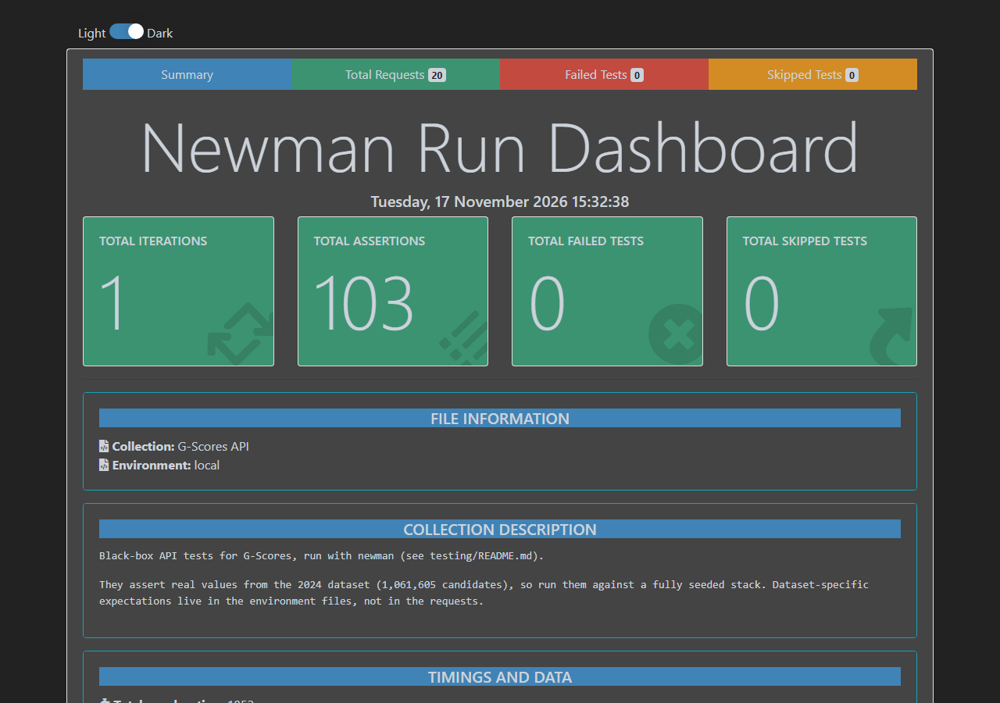</p>

**CI** ([`.github/workflows/ci.yml`](.github/workflows/ci.yml)) runs in four tiers; each starts only when the previous is green, and parts that do not
exist yet are skipped instead of failing:

1. **Lint and validate**: type-check backend and frontend, kubeconform on the Kubernetes manifests (Istio / cert-manager CRDs included), hadolint, `docker compose config`
2. **API integration**: build, unit tests and the Jest e2e suite against Postgres
3. **Compose stack**: `docker compose up --build` (seeds 1M rows), the smoke check, and the newman suite through nginx
4. **On `main`**: push the `api`, `seeder` and `web` images to GHCR, and an opt-in check of the live site

## Deployment

The images are built by CI and published to `ghcr.io/tinmh/gscores-{api,seeder,web}`. The live site runs on a single-node MicroK8s cluster behind
Cloudflare: Postgres as a StatefulSet, a one-shot migrate-and-seed Job, two replicas each of the API and nginx, exposed through an Istio gateway
with a Let's Encrypt certificate.

- First-time setup (DNS record, certificate, secret, apply): [`k8s/README.md`](k8s/README.md)
- Update the live site with one command, from your own `kubectl` context (so no cluster credential is stored on GitHub):

  ```bash
  bash scripts/deploy.sh --dry-run     # what runs now and what would change
  bash scripts/deploy.sh               # deploy the current main (migrates first, rolls back automatically if it fails)
  bash scripts/deploy.sh --rollback
  ```

## Assignment checklist

| Requirement | Where |
|---|---|
| Raw CSV into the database with a migration and a seeder, in the repo | `backend/src/database/migrations/`, `seed.ts` (`COPY`, idempotent) |
| Check scores by registration number | Score lookup page, `GET /api/students/:sbd` |
| Report: students per level (≥ 8, 6–8, 4–6, < 4) by subject, as a chart | Reports page (bar + pie), `GET /api/reports/score-levels`; overall mix on the Dashboard |
| Top 10 students of group A (Math, Physics, Chemistry) | Dashboard (A00 by default), `GET /api/rankings/A00` |
| Responsive design | 375 px phones, tablets, desktop |
| Docker | `docker compose up --build`, multi-stage Dockerfiles |
| Deployed live | https://gscores.appforsell.com (Kubernetes on a VPS rather than a PaaS) |
| React with Hooks, Rubik font | `useState` / `useEffect` / `useMemo` / custom hooks; Rubik via Google Fonts |
| **OOP for managing subjects** | `backend/src/subjects/domain/` |
| Form validation and tight logic | DTO validation (`class-validator`), `whitelist` + `forbidNonWhitelisted`, client-side checks, translated error states |
| ORM, TypeScript, PostgreSQL | TypeORM 0.3 (entities, repositories, migrations; raw SQL through the same data source for the ranking, `COPY` and the stats, see [How it works](#how-it-works)), TypeScript on both sides, PostgreSQL 16 |

Beyond the brief: English and Vietnamese, dark mode, user settings, pagination, a pre-aggregated overview endpoint, an automated API test suite, a four-tier CI
pipeline, and a one-command deploy with automatic rollback.

## Known limitations

- **Rate limiting trusts `X-Forwarded-For`** (`trust proxy: true`), so a client can spoof it and get around the 60 requests/minute limit; it should be set
  to the real number of proxy hops. The data is public and read-only, so the risk is mostly scraping.
- **No authentication**, by design: the data is public.
- **Single node, single database.** Postgres uses node-local storage; the data can be rebuilt from the CSV in about 30 seconds.
- **UI end-to-end tests are not part of the repository yet** (the API is covered by Jest and newman; the CI is ready to run Playwright when a config exists).

## Credits

Assignment and dataset by [Golden Owl](https://goldenowl.asia).
